# Explanation: architecture and trust boundaries

This design separates application delivery from identity issuance. Caddy is
close to each application, so it can reject an unauthenticated connection
before the local HTTP service handles a request. The signing service is centralized,
so client certificates have a consistent issuer and revocation lifecycle.

[Open the full-size diagram](architecture-and-trust.svg) · [Mermaid source](architecture-and-trust.mmd)

There is deliberately no network path from a client cluster to the signing
service. Caddy hosts receive public CA and revocation artifacts from the relay
only; they never receive `ca.key`, issuance access, or direct signing-server
VPN access.

The user's browser connects to `https://localhost:5059` through its SSH port
forward. This has no application DNS dependency: SSH reaches the site's IP,
then forwards the browser's TLS/mTLS stream to Caddy on the remote loopback
interface.

## Two independent trust systems

The server TLS certificate encrypts the browser-to-Caddy connection and lets
the browser authenticate the local forwarded endpoint. Caddy's `tls internal`
creates a certificate for `localhost` from Caddy's own local CA; clients must
trust that Caddy root or receive a warning. This is independent of the SSH host
key verification that establishes the tunnel to the site IP.

The client CA is different. Caddy uses its public certificate to decide whether
the connecting user certificate was issued by the trusted signing service. A
client certificate does not make the browser trust Caddy, and the Caddy server
certificate does not make Caddy trust a user.

## Why the HTTP upstream must be private

Caddy adds the authenticated identity after the client TLS handshake. If the
HTTP upstream were reachable directly, a caller could avoid mTLS and
potentially forge identity headers. Binding it to loopback (or isolating it on
a private Caddy-to-upstream network) makes Caddy the only practical source of
traffic and of the trusted identity header. Gunicorn is one example of such an
upstream. The app should still use the identity to authorize actions, not treat
possession of a valid certificate as authorization for every operation.

## What revocation changes

A certificate chain check answers “was this certificate issued by our CA and
is it within its validity dates?” A CRL answers the additional question “has
the CA subsequently withdrawn this certificate?” These are separate checks.

Publishing and synchronizing `crl.pem` is necessary but not sufficient. The
Caddy process must be configured with a verifier that actually consumes CRL
data, or a different enforcement component must make the decision before the
application acts. The standard Caddy documentation exposes custom verifiers,
but its bundled verifier is an explicit leaf allow-list rather than CRL
validation. Treat the module choice and a revoked-certificate acceptance test
as a production gate.

The signing service is a high-value, isolated system because it holds the CA
private key. A distribution relay is deliberately a different, lower-trust
component. The signing environment publishes signed public artifacts to it, or
a controlled job pushes them onward. Compromise of a relay must not expose the
CA key; signature verification at Caddy protects against an altered CRL.

A CRL is preferable to distributing a Caddy allow-list of valid certificates.
An allow-list must be refreshed at every site whenever anyone receives a new
certificate, whereas a CRL changes only for revocation and leaves all other
user certificates intact. A custom, signed serial deny-list is also viable if
a locally installed verifier validates its signature and freshness. In either
case, a site needs its own current local copy so that a temporary distribution
relay or signing-server outage does not disable normal access.

Polling creates a bounded but nonzero exposure period. A 15-minute interval
means a revoke may not take effect at every site until the next pull, transfer,
and reload complete. Short-lived certificates reduce the maximum lifetime of a
lost key but do not replace tested emergency revocation for high-risk access.

## Client-generated CSR requirement

This design requires the client device to generate the private key and submit
only a certificate signing request (CSR). A certificate authenticates whoever
holds its matching private key, so keeping that key off the signing server is
the intended private-key boundary.

The approved enrollment mechanism creates the key in the device's user or
hardware-backed key store, submits the CSR through the SSO-protected service,
and installs the returned public certificate chain against that same key. The
CSR contains a public key and request data; it does not contain the private
key. The signing service must not offer a server-generated key or PFX download.

Hardware-backed, non-exportable keys—such as keys in a TPM, Secure Enclave,
smart card, or managed device store—are preferred when available. They make
the certificate difficult to copy to another device. Each device therefore
needs its own enrollment; a lost or replaced device cannot recover its key and
must be revoked and re-enrolled. This is an intentional recovery trade-off.

The operational requirement is an enrollment implementation for each supported
client platform. It must generate the key, submit the CSR, and bind the issued
certificate to that key. Generic browser imports of a PEM certificate do not
reliably perform that binding, so the portal alone is not enough.

The signing service still derives the requester from the validated SSO session,
decides whether the requester is eligible, allocates a unique serial, applies
the approved subject and expiry policy, maintains the issuance and revocation
audit record, and publishes the signed revocation artifact. The protected
application still decides what an authenticated certificate identity is allowed
to do; mTLS establishes identity, not blanket application authorization.
